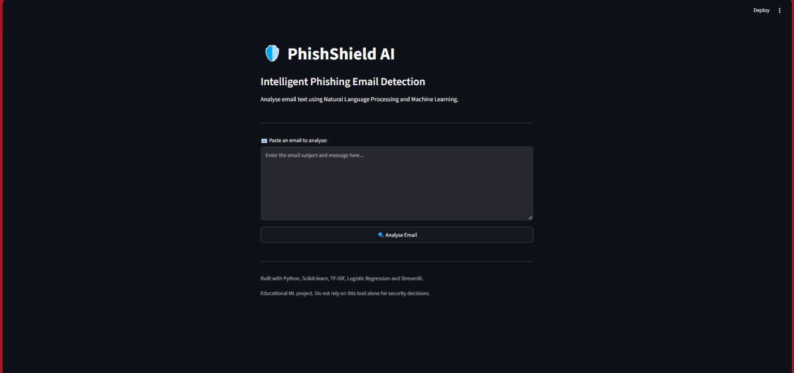
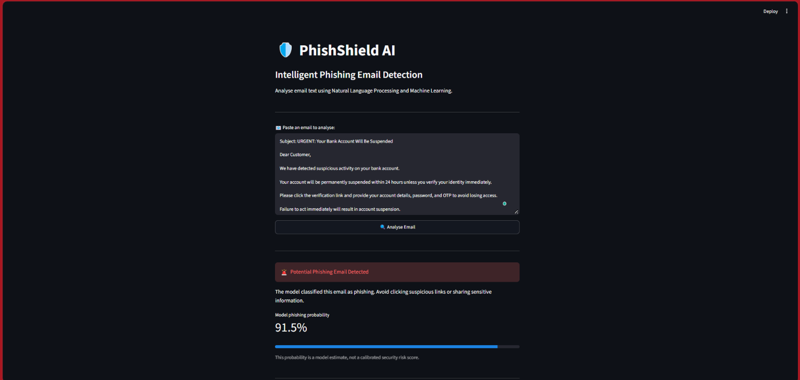
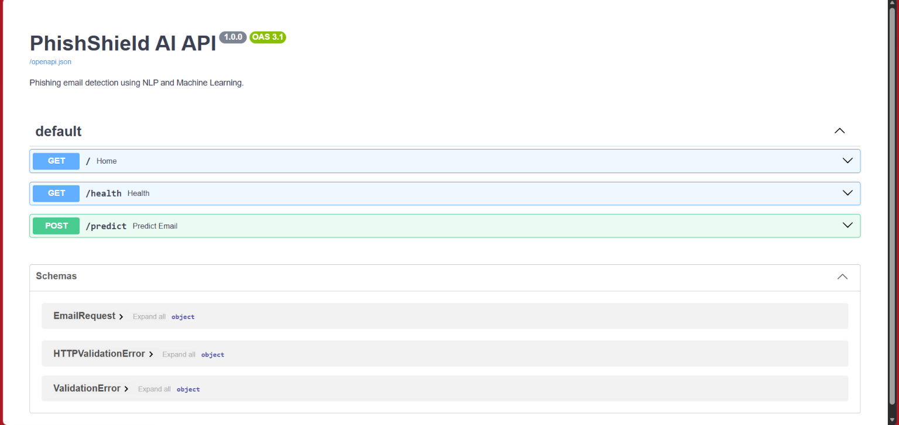

# 🛡️ PhishShield AI

### Intelligent Phishing Email Detection Using Machine Learning

**PhishShield AI** is an end-to-end Machine Learning and Cybersecurity project that uses **Natural Language Processing (NLP)** to classify email text as **Safe** or **Potential Phishing**.

The project combines a machine learning classification pipeline, an interactive **Streamlit dashboard**, a **FastAPI prediction service**, and automated API testing.

**🎯 Key Result: 97.46% accuracy on a held-out internal test set of 907 emails.**

---

## 🌟 Project Overview

Phishing is one of the most common cybersecurity threats, where attackers use deceptive emails to trick recipients into revealing sensitive information or interacting with malicious content.

PhishShield AI explores how machine learning can help identify suspicious email text by learning patterns from labelled email examples.

Users can paste email text into an interactive application and receive a classification along with an estimated phishing probability.

**The project demonstrates practical skills in:**

- Machine Learning and Natural Language Processing
- Cybersecurity and Phishing Detection
- Data Cleaning and Feature Engineering
- Model Training, Comparison, and Evaluation
- REST API Development
- Interactive Python Application Development
- Automated Testing

---

## ✨ Key Features

- **📧 Email Classification:** Classifies email text as Safe or Potential Phishing.
- **🧠 NLP-Based Detection:** Uses TF-IDF to transform email text into numerical features.
- **🤖 Machine Learning Model:** Uses Logistic Regression for classification.
- **🖥️ Interactive Dashboard:** Streamlit-based interface for analysing email text.
- **📊 Probability Estimates:** Displays the model's estimated phishing probability.
- **🚀 REST API:** FastAPI service for programmatic predictions.
- **🧪 Automated Testing:** API tests implemented using Pytest.
- **🔬 Model Comparison:** Compares Logistic Regression, Linear SVM, and Naive Bayes.
- **🛡️ Data Quality Checks:** Includes data cleaning, similarity-aware splitting, leakage checks, and error analysis.

---

## 🛠️ Technology Stack

| Category | Technologies |
|---|---|
| Programming Language | Python |
| Machine Learning | Scikit-learn |
| Natural Language Processing | TF-IDF |
| Data Processing | Pandas, NumPy |
| Web Application | Streamlit |
| REST API | FastAPI, Uvicorn |
| Testing | Pytest, HTTPX |
| Model Persistence | Joblib |
| Version Control | Git, GitHub |

---

## 🧠 Machine Learning Approach

The machine learning pipeline follows these steps:

1. **Data Collection:** Load and inspect the labelled email dataset.
2. **Data Cleaning:** Handle missing values and duplicate records.
3. **Data Splitting:** Create training, validation, and testing datasets using similarity-aware grouping.
4. **Feature Extraction:** Transform email text into TF-IDF features.
5. **Model Comparison:** Compare multiple machine learning algorithms.
6. **Model Training:** Train and save the selected Logistic Regression model.
7. **Model Evaluation:** Measure classification performance and analyse errors.
8. **Application Integration:** Integrate the trained model with Streamlit and FastAPI.
9. **API Testing:** Validate application endpoints using automated tests.

### 🔬 Model Comparison

Three machine learning algorithms were evaluated:

- Logistic Regression
- Linear Support Vector Machine (SVM)
- Naive Bayes

**Linear SVM achieved the highest validation F1-score** in the final comparison.

However, **Logistic Regression was retained for the application** because it supports probability estimates and integrates with the Streamlit dashboard and FastAPI service.

---

## 📊 Model Performance

The final Logistic Regression model was evaluated using a held-out internal test dataset.

| Evaluation Metric | Result |
|---|---:|
| Accuracy | **97.46%** |
| Precision | **97.39%** |
| Recall | **97.60%** |
| F1-Score | **97.50%** |
| Test Examples | **907** |

### 🔍 Evaluation and Data Leakage Checks

To improve evaluation reliability, the project uses similarity-aware dataset splitting.

- Emails with at least **98% character TF-IDF similarity** were grouped during dataset splitting.
- A subsequent check found **no cross-split matches at that threshold**.
- Additional checks and classification error analysis were performed.

**Important:** These results represent internal evaluation performance, not independently validated real-world phishing detection accuracy.

Some similar emails may remain below the 98% threshold, and certain source dataset labels may overlap with general spam.

---

## 📸 Application Screenshots

Screenshots of the working application will be included in this section.

### 🖥️ Streamlit Dashboard

Interactive interface for entering and analysing email text.

### 🔎 Email Classification Results

Prediction output showing the email classification and estimated phishing probability.

### 🚀 FastAPI Documentation

Interactive API documentation for testing prediction and health-check endpoints.

<!--
After uploading screenshots to a folder named screenshots,
the corresponding images can be displayed using:






-->

---

## 📁 Project Structure

```text
PhishShield-AI/
│
├── app.py
├── api.py
├── train_model.py
├── evaluate_model.py
├── compare_models.py
├── split_data.py
├── prepare_data.py
├── analyse_errors.py
├── check_leakage.py
├── check_near_duplicates.py
├── inspect_data.py
├── inspect_new_data.py
├── inspect_similar.py
├── test_streamlit.py
│
├── models/
│   ├── phishing_model.joblib
│   ├── model_comparison.csv
│   └── test_results.txt
│
├── tests/
│   └── test_api.py
│
├── requirements.txt
├── .gitignore
└── README.md
```

**Note:** The original training and evaluation dataset files are excluded from this GitHub repository.

---

## ⚙️ Installation and Setup

### 1️⃣ Clone the Repository

Clone the repository using Git:

```bash
git clone https://github.com/SaakshiJatav/PhishShield-AI.git
cd PhishShield-AI
```

Alternatively, download the repository as a ZIP file from GitHub and extract it.

### 2️⃣ Create a Virtual Environment

On Windows:

```powershell
py -m venv .venv
```

### 3️⃣ Install Dependencies

```powershell
.venv\Scripts\python.exe -m pip install -r requirements.txt
```

---

## 🖥️ Run the Streamlit Dashboard

Start the Streamlit application:

```powershell
.venv\Scripts\python.exe -m streamlit run app.py
```

Open the application in your browser:

**http://localhost:8501**

### 📧 How to Use the Application

1. Open the Streamlit dashboard.
2. Paste an email into the text input area.
3. Click **Analyse Email**.
4. Review the classification result.
5. View the model's estimated phishing probability.

The application displays whether the email text is classified as **Safe** or **Potential Phishing**.

---

## 🚀 Run the FastAPI Backend

Start the FastAPI service in a separate terminal:

```powershell
.venv\Scripts\python.exe -m uvicorn api:app --reload
```

Open the interactive API documentation:

**http://127.0.0.1:8000/docs**

### 🔗 API Endpoints

| Method | Endpoint | Description |
|---|---|---|
| GET | `/health` | Check API health |
| POST | `/predict` | Classify submitted email text |

The prediction endpoint accepts email text and returns a classification with supporting model information.

---

## 🧪 Automated Testing

The project includes automated tests implemented using Pytest.

Run the API tests:

```powershell
.venv\Scripts\python.exe -m pytest tests/test_api.py -v
```

### ✅ Test Results

**7 automated API tests passed.**

The test suite covers:

- API endpoint functionality
- Example classification predictions
- Invalid input handling

---

## 📧 Dataset

**Dataset:** Balanced Phishing Email Detection Subset

**Source:** [Hugging Face — Phishing Email Balanced 6000](https://huggingface.co/datasets/jhonrayo99/phishing-email-balanced-6000)

The original dataset contains **6,000 labelled email examples**.

| Label | Classification |
|---|---|
| 0 | Safe |
| 1 | Phishing |

Following data cleaning, **5,997 records** were used in the project.

The dataset is derived from an earlier phishing email collection and is published under the **LGPL-3.0** licence. Refer to the source dataset documentation for provenance, attribution, and licensing requirements.

**Note:** Raw dataset CSV files are not uploaded to this repository. Reproducing the training and evaluation process requires obtaining the source data separately.

---

## 🛡️ Project Scope and Limitations

PhishShield AI currently performs **text-based email classification only**.

The application does not independently:

- Verify sender identity.
- Inspect URL reputation.
- Scan email attachments for malware.
- Verify whether linked websites are legitimate.
- Guarantee that an email is safe.

The phishing probability is a **machine learning model estimate**, not a calibrated cybersecurity risk score.

This project is developed for **educational, research, and technical demonstration purposes**.

Its predictions should not be used as the sole basis for real-world security decisions.

---

## 🔮 Future Enhancements

Potential future improvements include:

- 🌐 Deployment of the application to a cloud platform.
- 🧠 Exploration of transformer-based NLP models.
- 🔍 Improved explainability of classification predictions.
- 🔗 Additional URL and cybersecurity indicator analysis.
- 📊 Evaluation on independent real-world phishing datasets.
- 📈 Model calibration and improved uncertainty analysis.

These are potential enhancements and are not features of the current implementation.

---

## 👩‍💻 Author

---

### Saakshi Jatav

- [GitHub](https://github.com/SaakshiJatav)
- [LinkedIn](https://www.linkedin.com/in/saakshi-jatav)

---

*Developed as a practical application of Machine Learning, Natural Language Processing, Cybersecurity, and interactive Python application development.*
